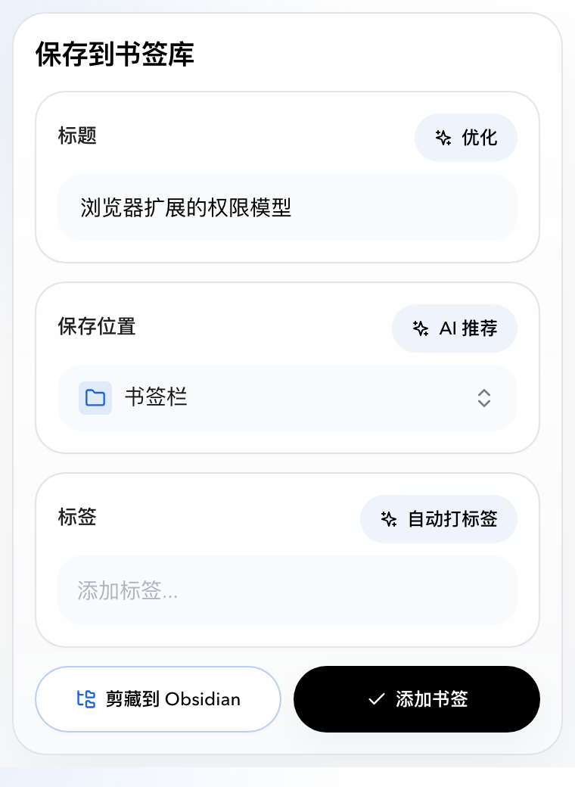
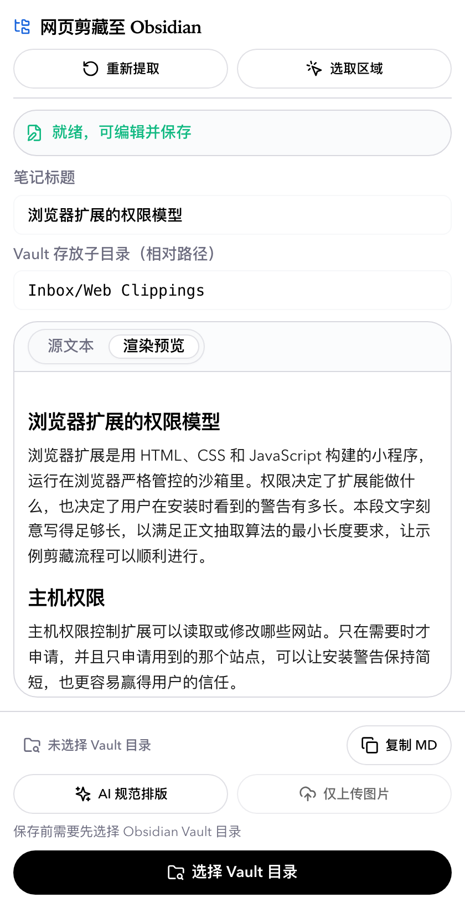
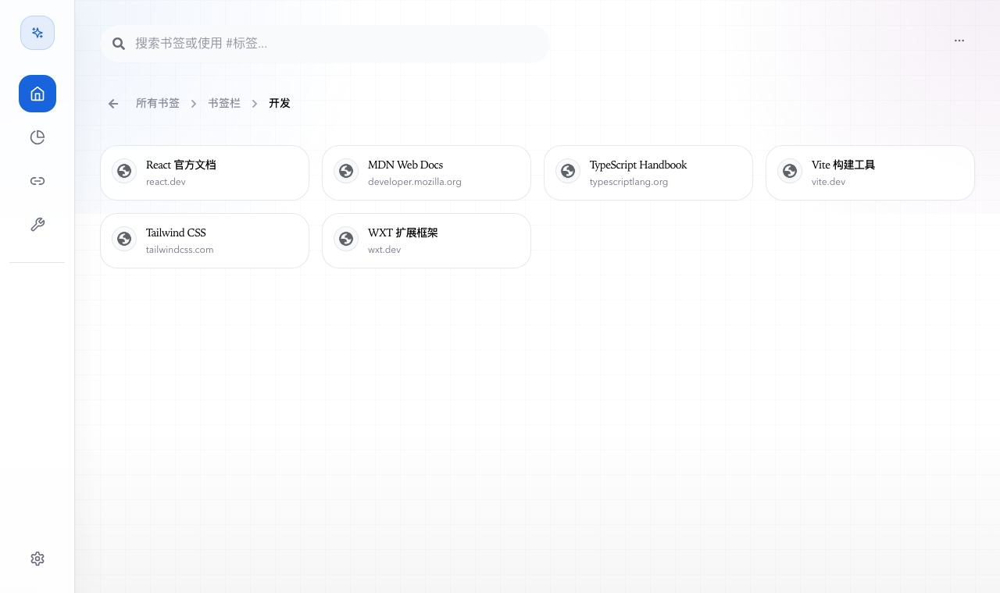
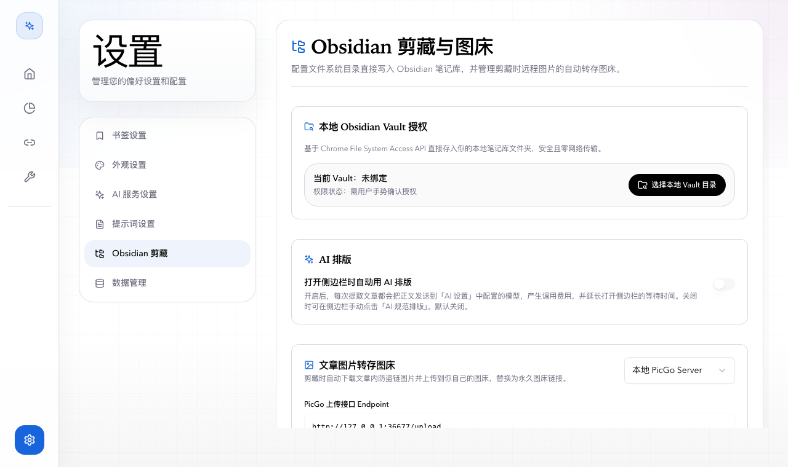
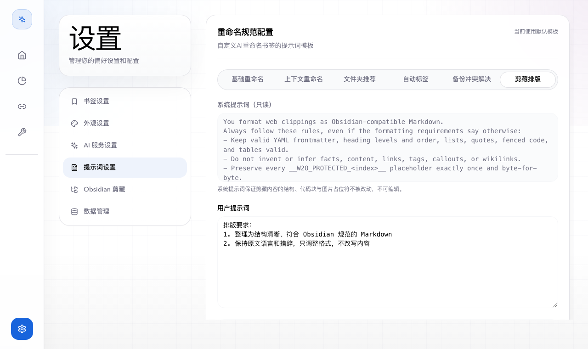
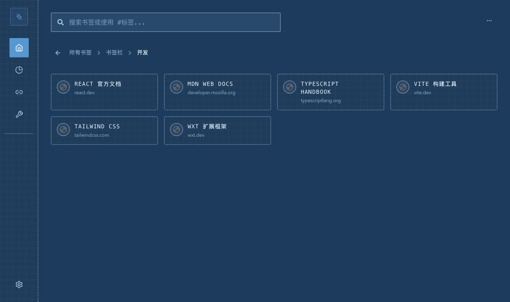

# Mustard Seed Bookmark

<div align="center">

**Mustard Seed Contains Sumeru · AI-Powered Smart Bookmark Manager**

[](https://github.com/Waverly-W/mustard-seed-bookmark)
[](LICENSE)

[简体中文](README.md) | **English**

</div>

---

## About

> "Mustard seed contains Sumeru" is a Buddhist metaphor: a tiny mustard seed can hold the immense Mount Sumeru. Mustard Seed Bookmark takes its name from this idea. It helps you collect, organize, and manage a great deal of information from the web inside a small browser extension.

Mustard Seed Bookmark is a browser extension (Chrome and Firefox) built with WXT, React, Tailwind CSS, and shadcn/ui. It combines AI assistance with local-first data handling to make bookmark management, web clipping, and note archiving smarter and easier.

- Runtime: Node >= 18
- Languages: Simplified Chinese and English; the first launch follows the browser language
- Look and feel: Default and Blueprint themes, light and dark modes, accent colors
- AI features: folder recommendation, smart rename, AI tags, backup conflict resolution, Markdown formatting for clipped pages
- Deep clipping: a built-in Web to Obsidian workflow that writes straight into your local vault, with PicGo or Cloudflare R2 image hosting
- Sync: WebDAV backup with smart incremental merge
- Template URLs: parameterized quick-search links, and one-click conversion from bookmarks to templates

---

## Screenshots

### Quick add and web clipping

<table>
  <tr>
    <td align="center" width="50%"><br><sub>Quick add popup: title, location, and tags, with optional AI help</sub></td>
    <td align="center" width="50%"><br><sub>Clipper side panel: extract, preview, and save to Obsidian</sub></td>
  </tr>
</table>

### Dashboard and settings



<sub>New tab: hierarchical bookmark tree, search, and tag filters</sub>



<sub>Settings: vault access, the AI auto-format switch, and image host configuration</sub>



<sub>Prompt settings: the system rules are fixed and read-only, the formatting requirements are editable and can be restored to default</sub>

### Blueprint theme



<sub>Blueprint theme (dark): every page uses the same theming mechanism</sub>

> The screenshots are generated by `npm run screenshots` from a real, loaded extension. The content comes from sample data.

---

## Features

### Quick add (Popup)
- **One-click save**: click the extension icon to save the current page
- **Smart extraction**: title, URL, and favicon are filled in automatically
- **Flexible editing**: edit the title, location, and tags before saving
- **AI folder recommendation**:
  - Analyzes the page and recommends the best folder, with one or several suggestions
  - Apply in one click, or pick a folder manually through the cascading selector
  - Degrades gracefully with timeouts; when AI fails or returns nothing, the popup says why
- **AI tag generation**: suggests semantic tags for the page
- **Shortcut**: jump straight into the Obsidian clipper

### Bookmark dashboard (New tab)
- **Hierarchical tree**: cascading navigation, folder expansion, and breadcrumbs
- **Views**: card grid and compact list
- **Search and filters**: fuzzy search by title or URL, exact filtering by `#tag`
- **Batch actions**: multi-select, batch move, and batch delete
- **Undoable deletes**: after deleting a bookmark or folder (or a batch), click "Undo" on the toast to restore the position, children, and tags
- **Statistics**: totals, folder count, duplicates, depth distribution, and more

### Obsidian clipper (Side panel)
- **Article extraction**: based on Mozilla Readability, with an area picker for clipping part of a page
- **Obsidian-compatible Markdown**: generated frontmatter, GFM syntax, tables, and task lists
- **AI formatting**: tidies the layout with the model from AI Settings while protecting code, formulas, and image placeholders. Automatic formatting is off by default, you can run it manually at any time, and the formatting requirements are editable in Prompt Settings
- **Direct vault writes**: writes into your local vault through the File System Access API and resolves file name conflicts
- **Image hosting**: local PicGo Server or Cloudflare R2 / S3, with an "Upload test image" button in settings to verify the setup
- **Resume unfinished clips**: reopening the side panel only resumes an unfinished clip that belongs to the current page; an unfinished clip of another page appears as a banner with "Resume" and "Discard"

### AI toolbox
- **AI batch rename**: improve the titles of a whole folder at once, with a style consistency check and a before/after review
- **AI batch tag**: generate structured tags for every bookmark in a folder, with merge and incremental tagging
- **AI classification**: semantic grouping suggestions for loose bookmarks

### Maintenance and health checks
- **Duplicate manager**: find duplicate links and merge or clean them
- **Link validity check**: probe links in bulk and flag 404s and timeouts
- **Empty folder cleanup**: find and delete empty folders

### Template URLs
- **Parameterized search**: define templates such as `https://github.com/search?q={keyword}`
- **One-click run**: enter the variables and open the generated page
- **Smart import**: detect patterned URLs in your bookmarks and turn them into templates

### Backup, sync, and restore
- **WebDAV backup**: works with Nutstore, Nextcloud, and other WebDAV servers, with manual backups and version management
- **Incremental merge**: compare local and remote snapshots, with AI-assisted conflict resolution
- **Import and export**: standard HTML bookmark files and JSON settings

### Settings
- **AI service wizard**:
  - Presets for OpenAI, DeepSeek, Moonshot, Claude (OpenAI-compatible), Ollama local models, and more
  - Both the `chat/completions` and `responses` protocols, including gateways that answer with Server-Sent Events (SSE)
  - Custom API Base URL, key, and model ID, with a live connection test
- **Prompt management**: customize or restore the rename, folder recommendation, auto tag, backup conflict, and clip format prompts; prompts are included in WebDAV backups
- **Appearance**: Default and Blueprint themes, light and dark modes that can follow the system, several accent colors
- **Internationalization**: complete Simplified Chinese and English interfaces

---

## Permissions and Privacy

- **Minimal install permissions**: the Chrome build does not ask to "read and change all your data on all websites" at install time. A feature that needs a site asks for that site when you click the related button, and only that site is granted.
- **When access is requested**:

| Feature | Site requested | Triggered by |
|---|---|---|
| AI service | The API address you configure | Testing or saving in AI Settings |
| Image host | The PicGo upload address, or `<accountId>.r2.cloudflarestorage.com` | Saving or uploading a test image in Obsidian settings |
| WebDAV backup | The WebDAV address you configure | Saving, testing, or backing up in Data Management |
| Link validity check | The sites in your bookmarks | Clicking "Start scan" |
| Reading the current page | The site of the current page | Clicking "Allow access" when the side panel asks |

- **Local first**: the API key and all settings stay in the browser; notes are written straight to the folder you choose.
- **AI requests stay under your control**: automatic AI formatting of clips is off by default, and the setting explains that the page text is sent to your configured model and may cost money.
- The Firefox build keeps the permissions declared at install time.

---

## Tech Stack

- **Framework**: [WXT](https://wxt.dev), a browser extension framework
- **UI**: React 18 + TypeScript
- **Styling**: Tailwind CSS 3 + [shadcn/ui](https://ui.shadcn.com)
- **Validation and storage**: zod; clip jobs are stored with Dexie (IndexedDB)
- **i18n**: i18next + react-i18next
- **Tests**: Vitest
- **Icons**: Lucide React + React Icons

---

## Getting Started

### Install

```bash
git clone https://github.com/Waverly-W/mustard-seed-bookmark.git
cd mustard-seed-bookmark
npm install
```

### Development

```bash
# Chrome
npm run dev

# Firefox
npm run dev:firefox
```

### Production build

```bash
# Build Chrome and Firefox
npm run build

# Build one browser
npm run build:chrome
npm run build:firefox

# Package as zip
npm run zip
```

### Load the extension

1. Run `npm run build`
2. Chrome: open `chrome://extensions/`, turn on "Developer mode", click "Load unpacked", and choose `dist/chrome-mv3`
3. Firefox: open `about:debugging`, click "This Firefox", click "Load Temporary Add-on", and choose `dist/firefox-mv2`; if a file picker opens, go into that folder and choose `manifest.json`

A temporary Firefox add-on is removed when the browser restarts. While developing you can run `npm run dev:firefox` instead; WXT starts Firefox and loads the extension for you.

---

## Configuration Guide

### AI service
1. Open a new tab and click "Settings" at the bottom left
2. Go to "AI Service" and use the wizard to pick a preset
3. Fill in the API Base URL (for example `https://api.openai.com/v1`), the API key, the model ID, and the protocol
4. Click "Test connection". The first time, the browser asks for access to that site; choose "Allow"

### Obsidian clipper
1. Go to "Settings - Obsidian Clipper", click "Choose vault folder", and grant access
2. (Optional) Configure an image host: choose PicGo or Cloudflare R2, fill it in, click "Upload test image" to verify, then save. Saved keys are never shown again; type a new value to replace them, or leave the field blank to keep the saved one
3. (Optional) Turn on "Format with AI automatically when the side panel opens". It is off by default
4. On the page you want to clip, click "Clip to Obsidian" in the popup, or choose "Clip this page to Obsidian" from the context menu, then preview and save in the side panel

See [docs/obsidian-clipper.md](docs/obsidian-clipper.md) (in Chinese) for details.

### Appearance and language
- **Theme**: Default or Blueprint; light, dark, or follow the system
- **Accent color**: pick the one you like
- **Language**: switch between Chinese and English

---

## Project Structure

```
mustard-seed-bookmark/
├── entrypoints/
│   ├── background.ts          # Background script: context menu, clip job message routing
│   ├── popup/                 # Quick add popup
│   ├── newtab/                # New tab: dashboard, tools, settings
│   └── sidepanel/             # Obsidian clipper side panel
├── components/
│   ├── settings/              # Settings sections
│   ├── tools/                 # Duplicates, link validity, empty folders
│   └── ui/                    # shadcn/ui primitives and shared components
├── lib/
│   ├── aiService.ts           # The single exit for AI requests
│   ├── aiApiCompat.ts         # Request building and response reading (JSON / SSE)
│   ├── ai/scenarios/          # Prompts and response schemas per AI scenario
│   ├── aiPromptUtils.ts       # Prompt defaults and custom prompt storage
│   ├── clipper/               # Web clipper: job state machine, extraction, conversion, image hosts, vault
│   ├── hostAccess.ts          # On-demand site access requests
│   ├── bookmarkTrash.ts       # Delete snapshots and undo
│   ├── webdavSync.ts          # WebDAV backup and incremental merge
│   └── i18nLocale.ts          # UI language resolution
├── locales/                   # Translations (en / zh_CN)
├── docs/                      # Docs and screenshots
├── scripts/                   # Icon and screenshot generators
└── public/                    # Extension icons and manifest localization
```

---

## Development and Contributing

- Conventions, architecture notes, and lessons learned are in [AGENTS.md](AGENTS.md); UI rules are in [FRONTEND.md](FRONTEND.md) and [DESIGN.md](DESIGN.md)
- Before committing, run:

```bash
npm run compile   # TypeScript type-check
npm run test      # unit tests
```

- When the UI changes visibly, run `npm run build:chrome && npm run screenshots` to refresh `docs/screenshots/`, and attach screenshots to the PR
- Keep `README.md` (Chinese, the default) and `README.en.md` in sync when you change either one

---

## Use Cases

- **Study and research**: save papers and references into well-organized folders
- **Work**: collect and organize work resources quickly
- **Inspiration**: keep design references and creative material
- **Reading list**: organize articles to read, and clip them as Obsidian notes

---

## FAQ

**Q: The connection test says "unknown error" or cannot parse the response.**
A: Some OpenAI-compatible gateways answer in SSE format (`data: ...`) even when streaming was not requested. The project handles both JSON and SSE responses. If it still fails, the error message now shows the real cause; check the address, key, and protocol type.

**Q: Clicking "Test connection" opened a "site access" prompt.**
A: That is expected. The extension does not ask for access to every website at install time. It asks for a site only when you configure a service that uses it. Choose "Allow". If you decline, the related feature will not work; click the button again to be asked once more.

**Q: The side panel says "Allow access".**
A: The site of the current page has not been granted to the extension yet. Click the button on the banner and choose "Allow"; the page is extracted again automatically. Browser-internal pages such as `chrome://` cannot be granted.

**Q: AI formatting did not run automatically when I clipped.**
A: Automatic formatting is off by default. Turn it on in "Settings - Obsidian Clipper", or click "AI Format" in the side panel to run it manually. If formatting fails, the original Markdown is kept and the reason is shown in the side panel.

**Q: I deleted a bookmark by mistake.**
A: For a few seconds after deleting, the toast shows an "Undo" button that restores the bookmark, or the whole folder with its tags. After that, the extension cannot bring it back.

**Q: The AI recommendation is not accurate.**
A: Customize the recommendation prompt in Prompt Settings, or choose a folder manually.

**Q: Which AI models are supported?**
A: Any model or gateway compatible with the OpenAI `chat/completions` or `responses` protocol, including OpenAI, DeepSeek, Moonshot, and Ollama.

**Q: Is my data safe?**
A: The API key and settings are stored only in your browser and are never uploaded to a third-party server. AI requests go directly to the address you configured.

---

## Known Limitations and Next Steps

- Merging duplicate bookmarks cannot be undone yet (a merge also edits the bookmark that is kept)
- Automatic AI formatting of a clip cannot be cancelled while it runs
- Clip jobs that were closed without saving stay on your device, and only the most recent one is offered back; automatic expiry is planned
- "Upload test image" leaves a 1x1 image on your image host, which you need to remove yourself
- Other Chromium browsers such as Edge have not been tested specifically

---

## Acknowledgements

Thanks to these open-source projects:

- [WXT](https://wxt.dev), the extension framework
- [shadcn/ui](https://ui.shadcn.com), the UI component library
- [Tailwind CSS](https://tailwindcss.com), the utility-first CSS framework
- [Lucide](https://lucide.dev), the icon library
- [Mozilla Readability](https://github.com/mozilla/readability), article extraction

---

## License

This project is released under the MIT License. See the [LICENSE](LICENSE) file.

---

## Get Involved

If this project helps you, please star it, file an issue, send a pull request, or share it with others.

---

<div align="center">

Made by [Waverly-W](https://github.com/Waverly-W)

**Mustard Seed contains Sumeru, manages bookmarks wisely**

</div>
