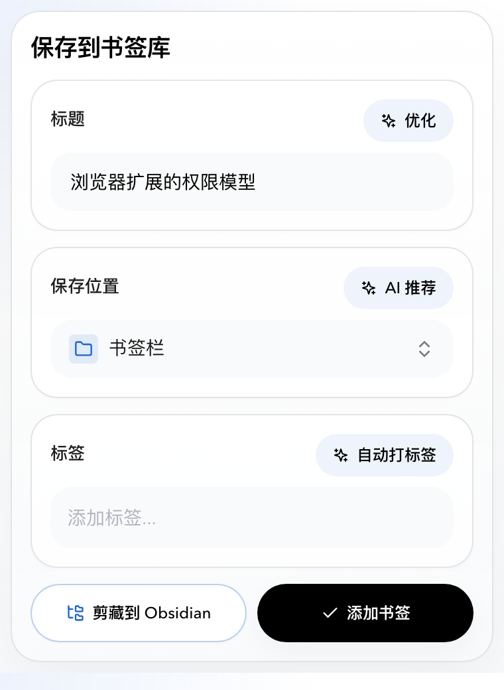
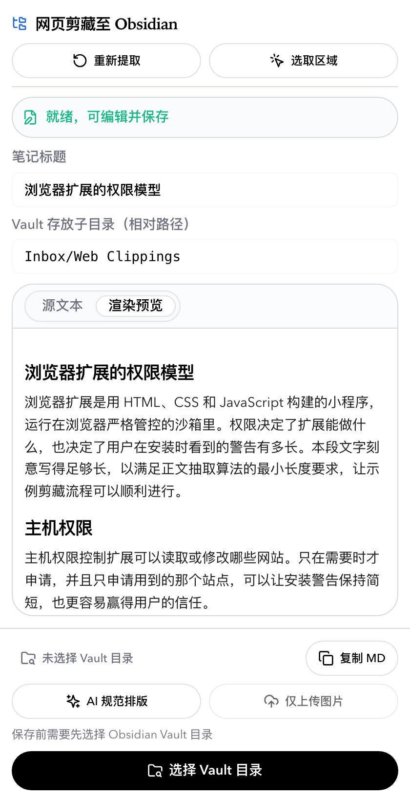
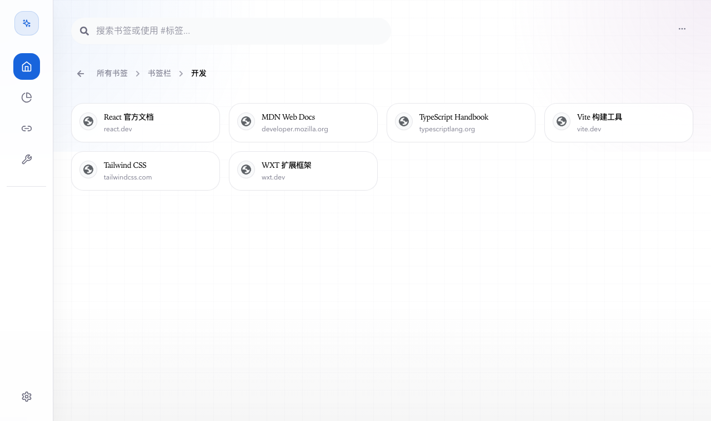
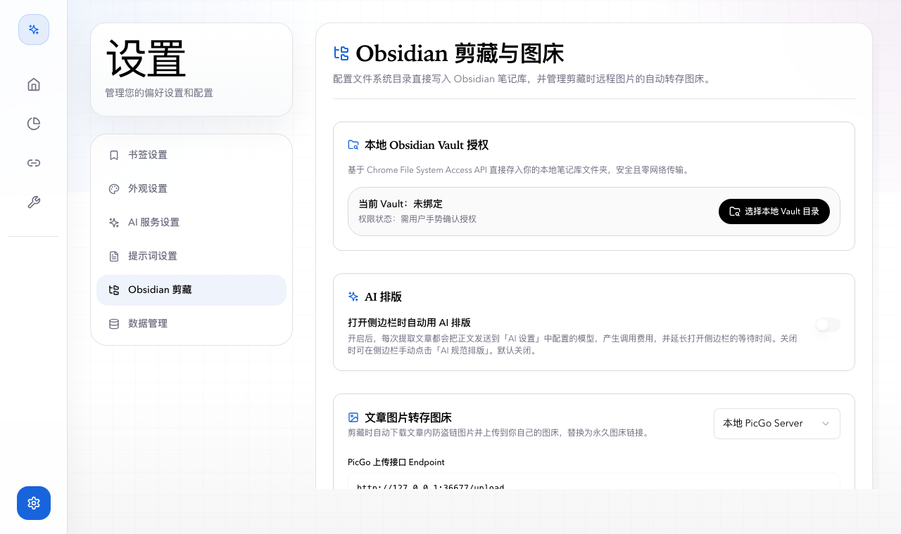
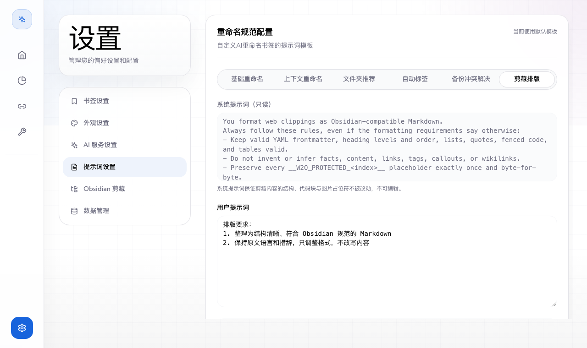
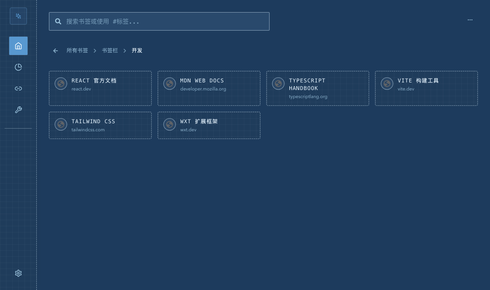

# 芥子书签 (Mustard Seed Bookmark)

<div align="center">

**芥子纳须弥 · AI 驱动的智能书签管理扩展**

[](https://github.com/Waverly-W/mustard-seed-bookmark)
[](LICENSE)

[简体中文](#关于芥子) | [English](#english-version)

</div>

---

## 关于芥子

> "芥子纳须弥"，佛家典故，意指微小的芥子中能容纳巨大的须弥山。芥子书签寓意于此，帮助你在微小的浏览器扩展中，智能地收纳、整理和管理浩瀚网络世界中的无限信息。

芥子书签是一款基于 WXT + React + Tailwind CSS + shadcn/ui 构建的现代化浏览器扩展（支持 Chrome 与 Firefox），集成 AI 能力与本地优先的数据处理，让书签管理、网页剪藏与知识归档变得智能、高效、优雅。

- 运行环境：Node >= 18
- 语言支持：简体中文 / English，首次使用时跟随浏览器语言
- 界面风格：默认主题与 Blueprint 主题切换，支持明暗模式与强调色
- AI 能力：智能分类推荐、智能重命名、AI 标签生成、备份冲突智能解决、网页正文规范化排版
- 深度剪藏：内置 Web to Obsidian 工作流，直接写入本地 Vault，支持 PicGo / Cloudflare R2 图床转存
- 数据同步：支持 WebDAV 备份与智能增量合并
- 模板 URL：支持参数化的动态快速检索与书签一键转模板

---

## 界面预览

### 快速添加与网页剪藏

<table>
  <tr>
    <td align="center" width="50%"><br><sub>快速添加弹窗：标题、位置、标签，AI 辅助可选</sub></td>
    <td align="center" width="50%"><br><sub>剪藏侧边栏：提取正文、预览、保存到 Obsidian</sub></td>
  </tr>
</table>

### 书签看板与设置



<sub>新标签页：层级化书签树、搜索与标签筛选</sub>



<sub>设置中心：Vault 授权、AI 自动排版开关、图床配置</sub>



<sub>提示词设置：系统规则固定只读，排版要求可自定义，支持恢复默认</sub>

### Blueprint 主题



<sub>Blueprint 主题（深色）：所有页面共用同一套主题机制</sub>

> 截图由 `npm run screenshots` 在真实加载的扩展里生成，页面内容来自示例数据。

---

## 核心功能

### 快速添加书签 (Popup)
- **一键添加**：点击扩展图标快速保存当前页面
- **智能提取**：自动提取页面标题、URL 与 Favicon
- **灵活编辑**：实时修改标题、保存位置与标签
- **AI 智能分类推荐**：
  - 分析页面内容，推荐最合适的文件夹，支持单个或多个推荐结果
  - 支持一键应用或手动级联选择
  - 智能降级与超时容错；AI 失败或没有结果时会明确提示原因
- **智能标签生成**：调用 AI 分析网页并推荐语义标签
- **快捷操作**：一键进入 Obsidian 深度剪藏

### 现代化书签管理看板 (Newtab)
- **层级化书签树**：级联导航、文件夹展开与路径追踪
- **多维度视图**：卡片网格与紧凑列表切换
- **搜索与过滤**：按标题、URL 实时模糊搜索，按 `#标签` 精准筛选
- **批量管理**：批量多选、批量移动与批量删除
- **可撤销删除**：删除书签、文件夹或批量删除后，可在提示条上点击"撤销"，恢复原位置、子项与标签
- **书签统计**：总数、文件夹数、重复数、层级分布等图表

### Obsidian 网页剪藏与归档 (Side Panel)
- **正文抽取**：基于 Mozilla Readability，支持在页面上框选区域提取
- **Obsidian 规范 Markdown**：自动生成 Frontmatter，支持 GFM 语法、表格与任务列表
- **AI 规范排版**：调用"AI 设置"中的模型整理排版，代码、公式、图片占位符受保护；默认关闭自动排版，也可随时手动触发；排版要求可在提示词设置中自定义
- **本地 Vault 直写**：基于 File System Access API 直接写入本地笔记库，自动处理文件名冲突
- **图床转存**：支持本地 PicGo Server 与 Cloudflare R2 / S3，设置页可"上传测试图片"验证配置
- **未完成任务恢复**：重新打开侧边栏时，只会自动恢复属于当前页面的未完成剪藏；其他页面的未完成剪藏以提示条形式提供"继续编辑"或"丢弃"

### AI 增强工具箱
- **AI 批量重命名**：选择文件夹一键优化书签标题，风格一致性检测，前后对比审查
- **AI 批量打标**：识别文件夹下书签内容并生成结构化标签，支持批量合并与增量打标
- **AI 智能分类整理**：对零散书签做语义归类推荐

### 书签维护与健康检查
- **重复书签管理**：扫描重复链接，一键合并或清理
- **链接有效性检查**：批量探测链接状态，标记 404 与超时的失效链接
- **空文件夹清理**：识别并批量删除冗余空目录

### 模板 URL (Template URLs)
- **参数化快速查询**：定义类似 `https://github.com/search?q={keyword}` 的动态链接模板
- **一键运行**：输入变量参数即可生成并打开目标网页
- **书签智能导入**：识别收藏夹中的模式化 URL，提炼并导入为动态模板

### 数据备份、同步与恢复
- **WebDAV 云端备份**：支持坚果云、Nextcloud 等自建或第三方 WebDAV，手动备份与版本管理
- **智能增量合并**：本地与远端快照对比，支持基于 AI 的冲突解决
- **导入导出**：支持标准 HTML 书签文件与 JSON 配置的导出与导入

### 配置中心
- **AI 服务配置向导**：
  - 支持 OpenAI、DeepSeek、Moonshot、Claude（OpenAI 兼容）、Ollama 本地模型等预设
  - 支持 `chat/completions` 与 `responses` 两种协议，兼容以流式（SSE）返回的网关
  - 自定义 API Base URL、Key、Model ID，并可实时测试连接
- **AI 提示词管理**：自定义或一键恢复重命名、分类推荐、智能打标、备份冲突解决、剪藏排版提示词；提示词会随 WebDAV 备份同步
- **个性化外观**：Default 与 Blueprint 双主题，明暗模式跟随系统，多种强调色
- **国际化**：简体中文与 English 完整界面

---

## 权限与隐私

- **最小权限安装**：Chrome 版安装时不会索取"读取和更改所有网站数据"。需要访问某个站点的功能，会在你点击对应按钮时单独弹窗，只授权该站点。
- **授权时机**：

| 功能 | 申请的站点 | 触发时机 |
|---|---|---|
| AI 服务 | 你配置的 API 地址 | AI 设置中测试连接或保存 |
| 图床 | PicGo 上传地址，或 `<accountId>.r2.cloudflarestorage.com` | Obsidian 剪藏设置中保存或上传测试图片 |
| WebDAV 备份 | 你配置的 WebDAV 地址 | 数据管理中保存、测试或备份 |
| 失效链接检测 | 书签里的各个网站 | 点击"开始检测" |
| 读取当前网页 | 当前网页所在站点 | 侧边栏提示"授权访问"时点击 |

- **本地优先**：API Key 与所有配置只保存在浏览器本地；笔记直接写入你选择的本地文件夹。
- **AI 请求可控**：剪藏时的 AI 自动排版默认关闭，开启前会说明正文将发送到你配置的模型并产生费用。
- Firefox 版沿用安装时声明的权限。

---

## 技术栈

- **框架**：[WXT](https://wxt.dev)，浏览器扩展开发框架
- **UI**：React 18 + TypeScript
- **样式**：Tailwind CSS 3 + [shadcn/ui](https://ui.shadcn.com)
- **数据校验**：zod；剪藏任务存储使用 Dexie (IndexedDB)
- **国际化**：i18next + react-i18next
- **测试**：Vitest
- **图标**：Lucide React + React Icons

---

## 快速开始

### 安装依赖

```bash
git clone https://github.com/Waverly-W/mustard-seed-bookmark.git
cd mustard-seed-bookmark
npm install
```

### 开发模式

```bash
# Chrome 开发模式
npm run dev

# Firefox 开发模式
npm run dev:firefox
```

### 生产构建

```bash
# 同时构建 Chrome 与 Firefox
npm run build

# 单独构建
npm run build:chrome
npm run build:firefox

# 打包为 zip
npm run zip
```

### 加载扩展

1. 运行 `npm run build`
2. Chrome：打开 `chrome://extensions/`，开启"开发者模式"，点击"加载已解压的扩展程序"，选择 `dist/chrome-mv3`
3. Firefox：打开 `about:debugging`，点击"此 Firefox"，点击"临时载入附加组件"，选择 `dist/firefox-mv2`；如果弹出的是文件选择器，则进入该目录并选择 `manifest.json`

Firefox 的临时附加组件会在重启浏览器后失效；开发调试时可以直接运行 `npm run dev:firefox`，由 WXT 启动 Firefox 并临时载入扩展。

---

## 配置指南

### AI 配置
1. 打开新标签页，点击左下角"设置"
2. 进入"AI 服务设置"，可使用配置向导选择预设
3. 填写 API Base URL（如 `https://api.openai.com/v1`）、API Key、Model ID，并选择协议类型
4. 点击"测试连接"：首次会弹出站点访问授权，选择"允许"

### Obsidian 剪藏
1. 进入"设置 - Obsidian 剪藏"，点击"选择本地 Vault 目录"并授权
2. （可选）配置图床：选择 PicGo 或 Cloudflare R2，填写后点击"上传测试图片"验证，再保存。已保存的密钥不会回显，更换时输入新值即可，留空表示保持不变
3. （可选）打开"打开侧边栏时自动用 AI 排版"。默认关闭
4. 在目标网页上从弹窗点击"剪藏到 Obsidian"，或在右键菜单中选择"剪藏当前网页至 Obsidian"，在侧边栏预览后保存

详细说明见 [docs/obsidian-clipper.md](docs/obsidian-clipper.md)。

### 外观与语言
- **主题**：Default 或 Blueprint，明亮、暗黑或跟随系统
- **强调色**：选择喜欢的主题色
- **语言**：切换中文或英文界面

---

## 项目结构

```
mustard-seed-bookmark/
├── entrypoints/
│   ├── background.ts          # 后台脚本：右键菜单、剪藏任务消息路由
│   ├── popup/                 # 快速添加弹窗
│   ├── newtab/                # 新标签页：书签看板、工具、设置
│   └── sidepanel/             # Obsidian 剪藏侧边栏
├── components/
│   ├── settings/              # 设置页各分区
│   ├── tools/                 # 重复书签、失效链接、空文件夹工具
│   └── ui/                    # shadcn/ui 基础组件与通用组件
├── lib/
│   ├── aiService.ts           # AI 请求的统一出口
│   ├── aiApiCompat.ts         # 请求体构造与响应读取（JSON / SSE）
│   ├── ai/scenarios/          # 各 AI 场景的提示词与响应结构
│   ├── aiPromptUtils.ts       # 提示词默认值与自定义存储
│   ├── clipper/               # 网页剪藏：任务状态机、抽取、转换、图床、Vault
│   ├── hostAccess.ts          # 按需申请站点访问权限
│   ├── bookmarkTrash.ts       # 删除快照与撤销
│   ├── webdavSync.ts          # WebDAV 备份与增量合并
│   └── i18nLocale.ts          # 界面语言解析
├── locales/                   # 国际化资源（en / zh_CN）
├── docs/                      # 文档与截图
├── scripts/                   # 图标与截图生成脚本
└── public/                    # 扩展图标与 Manifest 本地化
```

---

## 开发与贡献

- 开发规范、架构约定与踩过的坑见 [AGENTS.md](AGENTS.md)；界面规范见 [FRONTEND.md](FRONTEND.md) 与 [DESIGN.md](DESIGN.md)
- 提交前运行：

```bash
npm run compile   # TypeScript 类型检查
npm run test      # 单元测试
```

- 界面有可见变化时，运行 `npm run build:chrome && npm run screenshots` 更新 `docs/screenshots/`，并在 PR 中附上截图

---

## 使用场景

- **学习研究**：智能分类保存学术资料和参考文献
- **工作效率**：快速收集和整理工作相关资源
- **灵感收集**：保存设计灵感和创意素材
- **阅读列表**：整理待读文章，并剪藏为 Obsidian 笔记

---

## 常见问题

**Q: 测试连接提示"未知错误"或无法解析响应？**
A: 部分 OpenAI 兼容网关即使没有请求流式输出，也会以 SSE（`data: ...`）格式返回。本项目已统一处理 JSON 与 SSE 两种响应；如果仍失败，错误信息会展示真实原因，请根据提示检查地址、Key 与协议类型。

**Q: 点击测试连接时弹出了"访问网站"的授权？**
A: 这是预期行为。扩展安装时不索取全站权限，只在你配置某个服务时申请对该站点的访问。选择"允许"即可；拒绝后相关功能无法使用，重新点击按钮可再次申请。

**Q: 侧边栏提示"授权访问"？**
A: 当前网页所在站点尚未授权给扩展读取。点击提示条上的按钮并选择"允许"后会自动重新提取。`chrome://` 等浏览器内部页面无法授权。

**Q: 剪藏时 AI 排版没有自动执行？**
A: 自动排版默认关闭。可在"设置 - Obsidian 剪藏"中开启，或在侧边栏点击"AI 规范排版"手动执行。排版失败时会保留原始 Markdown，并在侧边栏显示原因。

**Q: 误删了书签怎么办？**
A: 删除后的几秒内，提示条上有"撤销"按钮，可恢复书签或整个文件夹及其标签。超过时间后无法通过扩展恢复。

**Q: AI 推荐不准确怎么办？**
A: 可以在提示词设置中自定义推荐提示词，也可以手动选择文件夹。

**Q: 支持哪些 AI 模型？**
A: 支持兼容 OpenAI `chat/completions` 或 `responses` 协议的模型与网关，包括 OpenAI、DeepSeek、Moonshot、Ollama 等。

**Q: 数据安全吗？**
A: API Key 与配置只保存在浏览器本地，不会上传到任何第三方服务器；AI 请求直接发往你配置的服务地址。

---

## 已知限制与后续改进

- 重复书签合并暂不支持撤销（合并还会修改保留的那一条）
- 剪藏的 AI 自动排版进行中无法取消
- 没有保存就关闭的剪藏任务会留在本地，目前只提示最近的一条，后续计划增加过期清理
- 图床"上传测试图片"会在图床中留下一张 1x1 图片，需要自行清理
- Edge 等其他 Chromium 浏览器尚未专门适配测试

---

## 致谢

感谢以下开源项目：

- [WXT](https://wxt.dev)，现代化扩展开发框架
- [shadcn/ui](https://ui.shadcn.com)，UI 组件库
- [Tailwind CSS](https://tailwindcss.com)，实用优先的 CSS 框架
- [Lucide](https://lucide.dev)，图标库
- [Mozilla Readability](https://github.com/mozilla/readability)，正文抽取

---

## 许可证

本项目采用 MIT 许可证。详见 [LICENSE](LICENSE) 文件。

---

## 参与项目

如果这个项目对你有帮助，欢迎 Star、提交 Issue 反馈问题、提交 Pull Request 贡献代码，或分享给更多人。

---

<div align="center">

Made by [Waverly-W](https://github.com/Waverly-W)

**芥子纳须弥，智理书签**

</div>

---

## English Version

# Mustard Seed Bookmark

<div align="center">

**Mustard Seed Contains Sumeru · AI-Powered Smart Bookmark Manager**

</div>

## About

> "Mustard seed contains Sumeru" is a Buddhist metaphor meaning a tiny mustard seed can contain the immense Mount Sumeru. Mustard Seed Bookmark embodies this idea: collect, organize, and manage a great deal of information from the web inside a small browser extension.

Mustard Seed Bookmark is a browser extension (Chrome and Firefox) built with WXT, React, Tailwind CSS, and shadcn/ui. It combines AI assistance with local-first data handling.

## Screenshots

| Quick add popup | Obsidian clipper side panel |
|---|---|
|  |  |


## Key Features

- **Quick add popup**: one-click saving with optional AI folder, title, and tag suggestions; failures are reported instead of failing silently
- **Bookmark dashboard**: hierarchical tree, search, `#tag` filters, batch actions, and undo for deletions
- **Obsidian clipper**: Readability-based extraction, Obsidian-compatible Markdown, optional AI formatting with protected code and image placeholders, direct write to a local vault, PicGo or Cloudflare R2 image hosting
- **AI toolbox**: batch rename, batch tag, smart classification, with editable prompts
- **Maintenance tools**: duplicate finder, link validity check, empty folder cleanup
- **Backup**: WebDAV backup with incremental merge and AI-assisted conflict resolution
- **AI gateways**: `chat/completions` and `responses` protocols, including gateways that answer with Server-Sent Events
- **Themes and languages**: Default and Blueprint themes, light and dark modes, English and Simplified Chinese

## Permissions

The Chrome build does not request access to all websites at install time. Features that need a site (your AI service, image host, WebDAV server, the page you are clipping, or link checking) ask for that site when you click the related button. The automatic AI formatting of clips is off by default.

## Quick Start

```bash
git clone https://github.com/Waverly-W/mustard-seed-bookmark.git
cd mustard-seed-bookmark
npm install

# Development
npm run dev

# Production build
npm run build

# Type-check and test
npm run compile
npm run test

# Regenerate README screenshots (after npm run build:chrome)
npm run screenshots
```

See [AGENTS.md](AGENTS.md) for architecture notes and contribution conventions.

## Tech Stack

- **Framework**: WXT
- **UI**: React 18 + TypeScript
- **Styling**: Tailwind CSS 3 + shadcn/ui
- **Validation and storage**: zod, Dexie
- **i18n**: react-i18next
- **Tests**: Vitest

## License

MIT License. See [LICENSE](LICENSE) for details.

---

<div align="center">

**Mustard Seed contains Sumeru, manages bookmarks wisely**

</div>
